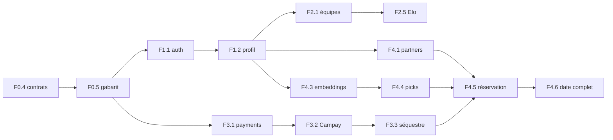

# Convexa : Roadmap des fonctionnalités

Cette roadmap est organisée pour l'ingénierie agentique : des **vagues**, des **identifiants stables** (`F0.1`, `F2.5`…), un **agent propriétaire** par fonctionnalité et des **dépendances explicites**. L'orchestrateur la transforme en fichiers de tâches (`tasks/T-xxxx-*.md`). Chaque identifiant a un prompt dans `agents/PROMPTS_FEATURES.md`.

**Pas de dates.** La vitesse réelle dépend de la relecture humaine, pas des agents. On planifie par vagues et par jalons produit.

**Tailles** : **S** = une session d'agent, une PR · **M** = une à deux sessions · **L** = à découper par l'orchestrateur en sous-tâches, chacune avec sa PR.

---

## Jalons produit

| Jalon | Contenu | Vagues |
|---|---|---|
| **J0 Fondations** | Dépôt, CI, gabarit de service, design system | 0 |
| **J1 Football ouvert** | Inscription validée + équipes, matchs, classements | 0, 1, 2 |
| **J2 Pilote rencontres** | Paiement Campay, restaurant, dates (50 étudiants, drapeau `dating_pilot`) | 3, 4 |
| **J3 Écosystème** | Talents, services entre étudiants, offres et sponsoring, abonnements Pro | 5 |
| **J4 Lancement école** | Tests de bout en bout, charge, sécurité, sauvegardes, bêta | 6 |

Le football est ouvert **en premier** (acquisition), les rencontres arrivent quand le ratio garçons/filles le permet.

---

## Vague 0 : Fondations

| ID | Fonctionnalité | Agent | Dépend de | Taille |
|---|---|---|---|---|
| F0.1 | Monorepo pnpm + Turborepo, outillage qualité | platform | | S |
| F0.2 | Environnement de développement Docker Compose | platform | F0.1 | M |
| F0.3 | CI et garde-fous (propriété, contrats, migrations) | platform | F0.1 | M |
| F0.4 | Paquets partagés : contrats, événements, messagerie (outbox/inbox), erreurs | architect | F0.1 | M |
| F0.5 | Gabarit de service NestJS et générateur | architect | F0.2, F0.4 | M |
| F0.6 | Observabilité de base | platform | F0.2, F0.5 | M |
| F0.7 | Design system et coquille de l'app web (PWA) | web-core | F0.1 | M |
| F0.8 | Gateway : squelette | gateway | F0.5 | M |
| F0.9 | Coquilles du back-office et du portail partenaire | web-core | F0.7 | S |

**Sortie de vague** : un service d'exemple généré par `pnpm new:service` passe la CI, expose `/health`, publie et consomme un événement, apparaît dans une trace bout en bout ; la coquille web s'installe comme PWA.

## Vague 1 : Socle (identité et notifications)

| ID | Fonctionnalité | Agent | Dépend de | Taille |
|---|---|---|---|---|
| F1.1 | Authentification : OTP WhatsApp et JWT | identity | F0.5, F0.8 | M |
| F1.2 | Inscription, profil, photo, matricule | identity | F1.1 | M |
| F1.3 | File de validation admin (API + écrans back-office) | identity | F1.2, F0.9 | M |
| F1.4 | Fiabilité, blocages, signalements | identity | F1.2 | M |
| F1.5 | Notifications, push web et WebSocket | realtime | F0.5, F1.1 | L |
| F1.6 | Écrans d'inscription, d'attente et de profil | identity | F1.2, F0.7 | M |

**Sortie de vague** : un étudiant s'inscrit avec un code WhatsApp, est validé par un admin, reçoit une notification push.

## Vague 2 : Football

| ID | Fonctionnalité | Agent | Dépend de | Taille |
|---|---|---|---|---|
| F2.1 | Équipes et effectif | football | F1.2 | M |
| F2.2 | Invitations et demandes d'adhésion | football | F2.1 | S |
| F2.3 | Terrains, défis et matchs | football | F2.1 | M |
| F2.4 | Chat des capitaines et filtre anti-chiffres | realtime | F1.5, F2.3 | M |
| F2.5 | Déclaration du score, validation, litiges, Elo | football | F2.3 | L |
| F2.6 | Statistiques joueurs, MVP, classements, badges | football | F2.5 | M |
| F2.7 | Écrans football | football | F2.1, F0.7 | L |
| F2.8 | Litiges et terrains : écrans back-office | football | F2.5, F0.9 | S |
| F2.9 | Compétitions (poules, phases finales) | football | F2.5 | M |

**Sortie de vague (jalon J1)** : deux équipes organisent un match, discutent sans pouvoir échanger un numéro, déclarent le score, l'Elo et les statistiques se mettent à jour, un litige est tranché par un admin.

## Vague 3 : Argent (en parallèle de la vague 2)

| ID | Fonctionnalité | Agent | Dépend de | Taille |
|---|---|---|---|---|
| F3.1 | Payments : grand livre, paiements, idempotence | money | F0.5 | L |
| F3.2 | Adaptateur Campay : collecte, statut, webhook, rapprochement | money | F3.1 | L |
| F3.3 | Séquestre, remboursements, reversements | money | F3.2 | L |
| F3.4 | Billing : plans, abonnements, droits | money | F3.1 | L |
| F3.5 | Écrans d'abonnement, de paiement et de finance admin | money | F3.3, F3.4, F0.9 | M |

**Sortie de vague** : un paiement de test réussit sur l'environnement demo de Campay, passe en séquestre, est remboursé ou libéré ; un abonnement s'active et ses droits sont lisibles par les autres services ; le rapprochement quotidien est à zéro.

## Vague 4 : Partenaires, restaurant, rencontres

| ID | Fonctionnalité | Agent | Dépend de | Taille |
|---|---|---|---|---|
| F4.1 | Partners : organisations, contrats, lieux, menu, formules, créneaux | partners | F1.2 | L |
| F4.2 | Portail restaurant | partners | F4.1, F0.9 | L |
| F4.3 | Questionnaire de rencontre et embeddings | dating, ai | F1.2, F0.5 | L |
| F4.4 | Propositions hebdomadaires et invitations | dating, ai | F4.3 | M |
| F4.5 | Négociation par cartes et saga de réservation d'un date | dating | F4.4, F4.1, F3.3 | L |
| F4.6 | Check-in, SOS, retour, révélation du contact, mise à jour vectorielle | dating, ai | F4.5 | L |
| F4.7 | Écrans rencontres | dating | F4.3, F0.7 | L |
| F4.8 | Durcissement avant pilote : sécurité et modération | security, qa | F4.6 | M |

**Sortie de vague (jalon J2)** : un couple de test va de l'invitation au retour après le date, avec paiement Campay, commande côté restaurant, SOS testé, numéros révélés seulement après « oui » mutuel.

## Vague 5 : Talents, services, partenariats

| ID | Fonctionnalité | Agent | Dépend de | Taille |
|---|---|---|---|---|
| F5.1 | Compétences, publications, candidatures, recommandations | talents, ai | F1.2, F0.5 | L |
| F5.2 | Missions avec séquestre et avis | talents | F5.1, F3.3 | M |
| F5.3 | Événements, billets, droits Pro | talents | F3.3, F3.4 | L |
| F5.4 | Rencontres « meeter » et messagerie libre | talents, realtime | F5.1, F1.5 | S |
| F5.5 | Marketplace : offres, formules, disponibilités, recherche | marketplace, ai | F1.2, F3.4 | L |
| F5.6 | Marketplace : commandes, livraison, litiges, avis | marketplace | F5.5, F3.3 | L |
| F5.7 | Offres et bons partenaires | partners | F4.1, F3.4 | M |
| F5.8 | Sponsoring, bannières et statistiques | partners | F4.1, F3.3, F3.4 | L |
| F5.9 | Écrans talents et marketplace | talents, marketplace | F5.1, F5.5, F0.7 | L |
| F5.10 | Écrans offres, bons et sponsoring | partners | F5.7, F5.8, F0.7 | M |

**Sortie de vague (jalon J3)** : une commande de service va de la demande au paiement, à la livraison, à la validation et à l'avis ; un bon d'offre est réclamé puis consommé chez un partenaire ; un organisateur Pro voit ses statistiques.

## Vague 6 : Lancement

| ID | Fonctionnalité | Agent | Dépend de | Taille |
|---|---|---|---|---|
| F6.1 | Suites de bout en bout des parcours critiques | qa | F2.7, F4.7, F5.9 | L |
| F6.2 | Tests de charge et de résilience | qa, platform | F6.1 | M |
| F6.3 | Revue de sécurité complète et protection des données | security | F6.1 | L |
| F6.4 | Sauvegardes, runbooks et alertes | platform | F0.6 | M |
| F6.5 | Manifestes Kubernetes (en perspective, optionnel) | platform | F6.4 | M |
| F6.6 | Bêta fermée : instrumentation et boucle de retours | orchestrator, qa | F6.1, F6.3 | S |

**Sortie de vague (jalon J4)** : parcours critiques verts en CI, sauvegarde restaurée avec succès, revue de sécurité sans point bloquant, bêta lancée.

---

## Chemin critique et parallélisme

Le **chemin critique vers les rencontres** passe par l'argent : `F0.4 → F0.5 → F3.1 → F3.2 → F3.3 → F4.5 → F4.6`. Pour ne pas bloquer le pilote, démarrer la vague 3 dès la fin de F0.5, **en parallèle** de la vague 2.

Voies parallèles possibles (aucune ne touche les chemins d'une autre, grâce à `ownership.yaml`) :

| Voie | Agents | Peut démarrer après |
|---|---|---|
| Plateforme | platform, architect | tout de suite |
| Front commun | web-core | F0.1 |
| Identité | identity, gateway | F0.5 |
| Football | football, realtime | F1.2 et F1.5 |
| Argent | money | F0.5 |
| Partenaires | partners | F1.2 |
| Rencontres | dating, ai | F1.2 (puis F3.3 pour la réservation) |

Plafond de concurrence recommandé : **3 à 5 agents à la fois**.

---

## Validations humaines obligatoires

Authentification (F1.1) · tout F3.x · révélation de contact (F4.6) · tout changement dans `deploy/` ou `.github/` · migrations destructrices · secrets et clés Campay de production · mises à jour majeures de dépendances · mises en production.

## Tâches humaines (hors agents)

Accord de l'école · contrat avec le restaurant · compte Campay de production avec décaissement activé · vérification des points « non confirmés » de `STACK.md` §3.2 · avis d'un juriste (conditions générales, données personnelles, détention de fonds) · choix du fournisseur d'OTP WhatsApp · nom de domaine et comptes d'hébergement · recrutement d'ambassadrices (équilibre garçons/filles) · charte de modération et formation du personnel du restaurant · validation des prix des plans · liste des services interdits.

---

## Trous connus des documents produit (à combler par les tâches indiquées)

Trouvés en préparant les prompts ; à traiter par ADR ou contrat avant de coder la fonctionnalité concernée.

| # | Trou | Où le traiter |
|---|---|---|
| 1 | Le grand livre de `schema.sql` est à **écriture simple** ; un système d'argent doit être à **double écriture** | F3.1 (ADR validé par un humain) |
| 2 | Aucun moyen de **reversement** : numéro MoMo/Orange du bénéficiaire (distinct du WhatsApp), absent pour les prestataires et pour `partners.organizations` | F3.3 (endpoint) et F4.1 (colonne) |
| 3 | `GET /users?team=none` exige l'appartenance à une équipe, qui vit dans Football | F1.2 + F2.1 (copie locale alimentée par événements) |
| 4 | `restaurant_credits` (compensation d'absence) : quand et comment le crédit est appliqué à un paiement n'est pas défini | F4.6 + F3.3 (ADR) |
| 5 | **Fournisseur d'OTP WhatsApp** non choisi | ADR avant F1.1 |
| 6 | **Règle du payeur** hors couples garçon/fille (question produit n°2) | F4.5 : règle isolée dans une fonction testée ; cas non couverts refusés |
| 7 | **Fenêtre de vote du MVP** non définie | F2.6 (ADR, proposition : 24 h) |
| 8 | **Dimension et construction des vecteurs de rencontre** (64 par bloc) à justifier | F4.3 (ADR par l'agent `ai`) |
| 9 | Points « non confirmés » de Campay (webhook, frais, remboursement) | Humain, avant F3.2 |

---

## Hors roadmap (versions suivantes)
Dates de groupe (3+3), mode « on partage l'addition », plusieurs restaurants, boutique de maillots, pronostics sans argent, plusieurs écoles.
