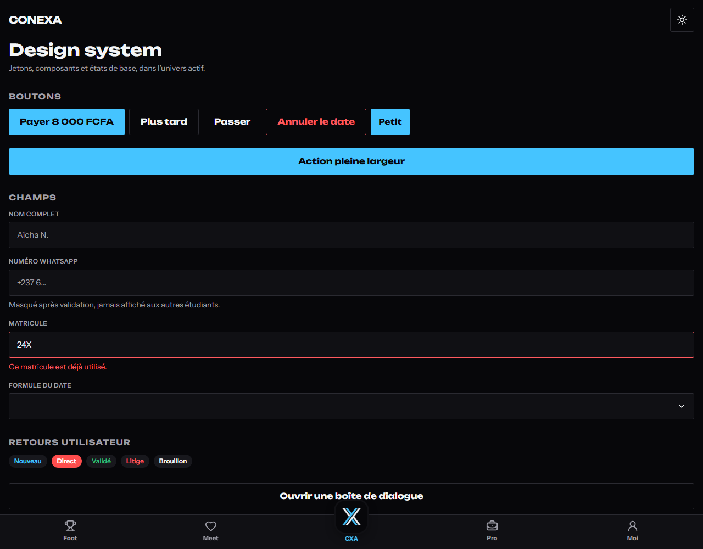
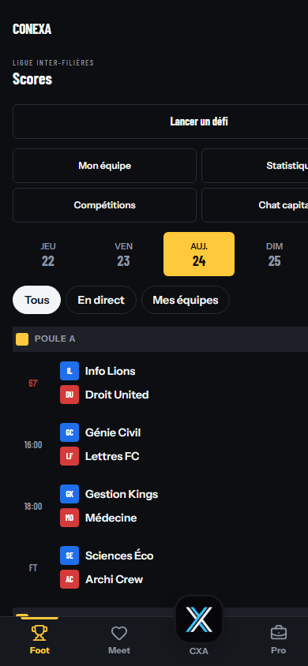

# Domaine : web-core

Socle front partagé : jetons de design, composants, coquille PWA, navigation générée. Propriétaire : agent `web-core` (voir `agents/ownership.yaml`).

## Où vit quoi

| Élément | Chemin | Rôle |
|---|---|---|
| Jetons et preset Tailwind | `packages/ui/src/styles.css`, `packages/ui/tailwind-preset.cjs` | Variables CSS des univers (`s-core`, `s-foot`, `s-meet`, `s-pro`) et des thèmes (`dk`, `lt`), exposées à Tailwind |
| Composants | `packages/ui/src/*.tsx` | Button, Input, Select, Dialog, Sheet, Tabs, Toast, Avatar, Badge, Skeleton, EmptyState, Table, Card |
| Coquille | `apps/web/src/shell/` | Thème, barre basse, gardes de session, client d'API, i18n, PWA |
| Écrans globaux | `apps/web/src/app/` | Accueil Core, démonstration du design system, écran hors-ligne |
| Registre de navigation | `apps/web/src/shell/nav.generated.ts` | **Généré** depuis `apps/web/src/features/*/nav.ts` |

## Commandes

```bash
pnpm --filter @conexa/web exec next dev -p 3107   # la Gateway occupe le port 3000
pnpm --filter @conexa/web gen:registry            # régénère la navigation depuis features/*/nav.ts
pnpm --filter @conexa/web build                   # build Next + service worker Serwist
pnpm turbo run lint typecheck test build --filter=@conexa/ui --filter=@conexa/web
```

Le script racine `pnpm gen:registry` demandé par `AGENTS.md` n'existe pas encore : `package.json` racine appartient à `platform`. La commande équivalente vit dans `apps/web` ; un alias racine demande une tâche `platform` (voir `deps_request` de T-0007).

## Ajouter un écran de domaine

1. Créer `apps/web/src/features/<domaine>/nav.ts` (objet `{ label, href, universe, order }`, export par défaut).
2. Créer l'écran dans le même dossier, puis la route `apps/web/src/app/(app)/<section>/page.tsx` qui le rend.
3. Lancer `pnpm --filter @conexa/web gen:registry`.

Aucun fichier partagé n'est modifié à la main : l'accueil liste la nouvelle entrée et la barre basse reste inchangée. Les routes inconnues des quatre univers affichent un écran d'attente (`(app)/[...universe]`), qui s'efface dès qu'une route statique existe.

## Maquettes mobiles (2026-10-26)

Les 23 écrans mobiles de `docs/product/design/` sont rendus avec les données fictives de
`apps/web/src/shell/maquettes/data.ts`. Le thème clair/sombre est celui de la coquille, pas un
doublon de page.

| Univers | Routes |
|---|---|
| Chargement et compte | `/splash`, `/login`, `/signup`, `/pending` (sans barre basse) |
| Core | `/`, `/me`, `/me/notifications` |
| Foot | `/football`, `/football/match`, `/football/classement`, `/football/equipe` |
| Meet | `/meet`, `/meet/match` (plein cadre), `/meet/dates`, `/meet/lieu`, `/meet/paiement`, `/meet/jour`, `/meet/profil` |
| Pro | `/pro`, `/pro/reseau`, `/pro/emplois`, `/pro/profil`, `/pro/premium` |

Les écrans lisent uniquement des constantes locales : aucun appel réseau, aucun prix ni règle
d’accès recalculé côté client. Les agents de domaine remplaceront les données par leurs contrats
et pourront réutiliser `shell/maquettes/kit.tsx` (en-tête, écussons, lignes de match, photos
fictives). Les portails desktop (partenaire, back-office) restent hors de ce périmètre (T-0009).

## Compléments hors maquette (2026-10-26)

Les maquettes ne couvraient ni le chat, ni le parcours de paiement complet, ni l'OTP, ni plusieurs gestes métier. Ils sont ajoutés en maquette interactive, toujours avec des données fictives :

| Parcours | Routes | Interaction |
|---|---|---|
| Vérification WhatsApp | `/verifier` | Code à 6 chiffres, collage, renvoi ; `login` ne saisit plus que le numéro |
| Meet | `/meet` | Glisser à droite = inviter, à gauche = passer ; boutons et flèches clavier équivalents, respect de `prefers-reduced-motion` |
| Date | `/meet/match`, `/meet/chat`, `/meet/jour` | Animation de match, fil de discussion, cartes rapides |
| Paiement | `/meet/paiement`, `.../attente`, `.../recu`, `.../echec` | Opérateur, numéro validé, séquestre, reçu, échec et nouvelle tentative |
| Football | `/football/defi`, `/football/score` | Défi (équipe, terrain, date), déclaration de score marquée « non confirmé » |
| Pro | `/pro/publier`, `/pro/offre` | Composer un post, détail d'une mission et candidature |
| Moi | `/me/paiements`, `/me/confidentialite` | Séquestre/remboursement, préférences, export, suppression confirmée |

- **Chat** : `shell/maquettes/chat-filter.ts` imite la règle serveur de `API.md` §3 — chiffres (y compris Unicode), nombres en lettres, liens, pseudos et demandes de contact refusés, avec explication. Testé dans `chat-filter.test.ts`.
- **Paiement** : aucun montant n'est débité ; l'étape d'attente annonce qu'elle est simulée. Les écrans `attente`/`recu`/`echec` servent à valider la copie et les états, pas la logique Campay.
- **Aucun minuteur artificiel** : le renvoi du code est immédiat et la maquette ne fabrique pas d'urgence. Les cartes rapides du chat évitent les chiffres (« en retard » au lieu de « retard 5 min »).

## Client Gateway (T-0019, 2026-10-27)

Le front parle au Gateway, pas aux services directement. Le Gateway écoute sur `http://localhost:3000`
en développement ; l'URL publique (préfixe `/api/v1` inclus) vient de `NEXT_PUBLIC_API_URL`.

| Fichier | Rôle |
|---|---|
| `apps/web/src/shell/api/client.ts` | Transport : URL de base, jeton `Bearer`, `Idempotency-Key`, curseurs, `204`, erreurs normalisées (`ApiError` avec `code`, `status`, `details`, `request_id`) |
| `apps/web/src/shell/api/endpoints.ts` | Appels typés par domaine, chemins alignés sur `services/*/gateway.routes.json` |
| `apps/web/src/shell/api/errors.ts` | Messages français ; la liste des codes vient de `@conexa/contracts` (`ErrorCode`), un code ajouté aux contrats casse le typecheck |

- **Types** : les réponses (`Me`, `Plan`, `Team`, `DatingDate`, `Post`, `Mission`, `Message`, `ServiceOrder`…)
  et les entrées (`RegisterInput`, `SubscribeInput`, `SendMessageInput`…) viennent de `@conexa/contracts`.
  Aucun schéma n'est recopié dans l'app.
- **Chemins** : `/me` et `/auth/*` à la racine (Identity), `/football/*`, `/dating/*`, `/dates/*`,
  `/posts`, `/missions`, `/services`, `/service-orders`, `/billing/*`, `/messaging/threads`,
  `/notifications`. Ils suivent les manifestes du Gateway, pas les chemins historiques d'`API.md`.
- **Idempotence** : `billing.subscribe`, `dating.pay` et `talents.fundMission` exigent une clé
  en argument, conformément à `API.md` §1.
- **Aucune règle métier côté front** : l'Elo, les quotas de picks/invitations, les commissions,
  les droits Premium et les montants viennent des réponses serveur. Les maquettes affichent encore
  des fixtures (`shell/maquettes/data.ts`, prix Premium) ; elles ne recalculent ni commission ni
  classement, et seront remplacées écran par écran par les appels typés.
- **Tests** : `endpoints.test.ts` vérifie les URL (préfixes, encodage, curseurs), l'en-tête
  d'idempotence, la lecture de `/billing/plans` et les routes de messagerie. `client.test.ts`
  couvre le transport, les erreurs et le `204`.

## Règles de design appliquées

- Un univers par section d'URL (`football`, `meet`, `pro`, sinon Core), thème par défaut de la maquette, choix de thème mémorisé dans `localStorage`.
- Cibles tactiles de 44 px minimum, contraste AA, aucun état porté par la seule couleur.
- `prefers-reduced-motion` et le réglage « Réduire les animations » coupent toutes les animations.
- Prix, Elo, révélation de contact et règles d'accès restent côté serveur ; l'interface affiche seulement.

## PWA

- Manifeste généré par `apps/web/src/app/manifest.ts` (icônes 192/512 et maskable dans `public/icons/`).
- Service worker Serwist (`apps/web/src/app/sw.ts`) : précache, repli hors-ligne sur `/offline`, mise à jour proposée par `shell/pwa/update-prompt.tsx` (jamais imposée).
- Notifications : `shell/pwa/push.ts` (VAPID, clé publique `NEXT_PUBLIC_VAPID_PUBLIC_KEY`, abonnement sur geste explicite). L'envoi appartient au service Realtime.

## Consoles desktop (T-0009, 2026-10-26)

Deux apps Next.js partagent le design system et la politique de rôles de `@conexa/ui` :

| App | Port dev | Rôles | Routes |
|---|---|---|---|
| `apps/backoffice` | 3001 | `admin`, `moderator` | `/` (Validation), `/litiges`, `/finance`, `/demo` |
| `apps/partner-portal` | 3002 | `partner_staff`, `restaurant_staff` | `/` (Ce soir), `/menu`, `/creneaux` |

- Coquille commune (`src/shell/console-frame.tsx`) : mot-symbole, sections, compte, thème sombre/clair mémorisé. Barre du haut sur desktop, deuxième ligne défilante sous `md` ; les pages restent utilisables à 390 px (le portail remplace le tableau par des cartes).
- Garde de rôle : `src/shell/access.ts` déclare les rôles, `shell/session.tsx` les applique dans le layout de route (`(admin)`, `(portal)`). `@conexa/ui/access` porte la décision, testée pour chaque app (rôle étranger → refus, compte en attente, absence de session).
- **Aperçu local sans Identity** : `NEXT_PUBLIC_CONSOLE_PREVIEW_SESSION=true` fournit un compte de maquette. Sans cette variable, le build de production affiche « Connexion requise ». Ne jamais la poser en production.
- Navigation générée par app : `pnpm --filter @conexa/<app> gen:registry` lit `src/features/*/nav.ts`. L'écran `/demo` du back-office montre qu'un domaine n'ajoute que ses trois fichiers.
- Données de maquette dans `src/shell/fixtures.ts` (fictives, XAF) ; les actions (valider une arrivée, un compte) restent locales et l'annoncent, aucune écriture serveur.

```bash
pnpm --filter @conexa/backoffice dev          # http://localhost:3001
pnpm --filter @conexa/partner-portal dev     # http://localhost:3002
NEXT_PUBLIC_CONSOLE_PREVIEW_SESSION=true pnpm --filter @conexa/backoffice dev
pnpm --filter @conexa/backoffice gen:registry
pnpm turbo run lint typecheck test build --filter=@conexa/backoffice --filter=@conexa/partner-portal
```

## Vérifications (T-0007, 2026-10-26)

```
pnpm turbo run lint typecheck test build --filter=@conexa/ui --filter=@conexa/web
  Tasks: 11 successful, 11 total

@conexa/ui  8 tests (Button, Input, EmptyState, Avatar, Badge, Table, Skeleton)
@conexa/web 21 tests (gardes de session, catalogue d'erreurs, client d'API, registre de navigation)

Lighthouse 12 (Chrome headless, build de production, http://localhost:3108) :
  performance 94 · accessibilité 100 · bonnes pratiques 100
  PWA : aucun audit en échec (manifeste installable, service worker, hors-ligne)

Service worker (navigateur, build de production) :
  scope http://localhost:3108/ · state activated · controller true
  cache serwist-precache-v2-http://localhost:3108/

Routes générées : /, /demo, /design, /offline, /manifest.webmanifest, /[...universe]
```

## Vérifications (T-0019, 2026-10-27)

Fusion de T-0007 et T-0009 sur `main` (13 services, contrats à jour), puis :

```
pnpm turbo run lint typecheck test build \
  --filter=@conexa/ui --filter=@conexa/web \
  --filter=@conexa/backoffice --filter=@conexa/partner-portal
  Tasks: 20 successful, 20 total

Tests : ui 14 · web 31 · backoffice 11 · partner-portal 8 = 64
Build : les trois apps compilent, toutes les routes statiques sont générées
pnpm format:check : All matched files use Prettier code style!
```

Captures (build de production, port 3109) :





## Limites connues

- **Écrans de maquette** : les 23 écrans mobiles et les deux consoles lisent encore des fixtures ;
  le client typé (`shell/api/endpoints.ts`) est la couture prête pour les agents de domaine.
  Le prix Premium de la maquette est une fixture : l'écran devra lire `/billing/plans` quand la
  session et le rôle seront fournis par Identity.
- **Consoles desktop** : `apps/backoffice` et `apps/partner-portal` n'ont pas encore de client d'API ;
  leurs actions restent locales et l'annoncent.
- **Authentification** : les gardes (`shell/auth/guards.ts`) sont testées mais aucune session n'est fournie tant que F1.1 n'existe pas ; l'app est publique en attendant.
- **Police** : les WOFF2 de la maquette sont copiés dans `apps/web/public/fonts/` (676 Ko, latin uniquement).
- **Lighthouse** : l'audit d'installation reste à joindre à la PR (voir T-0007).
