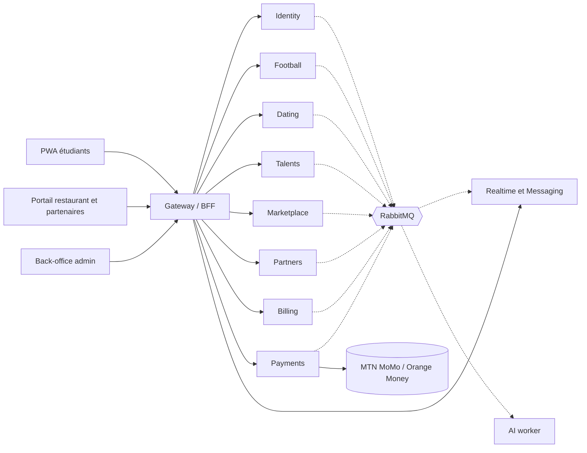

# Convexa : Architecture microservices (v2)

Cette version remplace la proposition à 6 services. Elle ajoute trois domaines qui n'étaient pas couverts : **Partenariats**, **Services entre étudiants** et **Abonnements Pro**.

---

## 0. Ce qui change

| Sujet | Avant | Maintenant |
|---|---|---|
| Services entre étudiants | Un type de publication (`service_offer`) + missions simples | Service **Marketplace** : catalogue d'offres à 3 formules, commandes, séquestre, livraison, révisions, litiges, avis |
| Abonnements Pro | Une ligne « v1.2 », aucune table, aucun endpoint | Service **Billing** : plans, abonnements, factures, codes promo, droits (*entitlements*) appliqués par tous les services |
| Partenariats | Un champ texte `sponsor_name` | Service **Partners** : organisations partenaires, contrats, sponsoring, offres étudiantes avec bons (QR), bannières avec statistiques, portail partenaire |
| Restaurant | Fusionné avec Talents | Devient un **partenaire de type `restaurant`** dans Partners (même onboarding, contrat, portail). Prépare le multi-restaurants |
| Paiements | Une liste de types d'objets | Étendus : `service_order`, `subscription`, `sponsorship` |
| Auth et temps réel | « Supabase Auth / Realtime » | Le service **Identity** émet les JWT (OTP WhatsApp maison). Le temps réel passe par le service **Realtime & Messaging**. Voir §10 |

---

## 1. Principes

1. **Un service = un domaine = un schéma PostgreSQL.** Aucune jointure ni clé étrangère entre schémas de services différents : seulement des `uuid`.
2. **Les données d'un autre service se lisent par API ou par événement**, jamais en base. Les copies locales (*read models*) sont alimentées par événements.
3. **Tout ce qui est sensible reste dans le service propriétaire** : numéro WhatsApp (Identity), argent (Payments), contacts révélés (Dating).
4. **Événements fiables** : pattern *outbox* (écrit dans la même transaction que la donnée) + *inbox* (idempotence à la réception).
5. **Pas d'avantage sportif à vendre.** Aucun abonnement n'influence l'Elo, les classements ni le nombre de swipes de rencontre (règle des 3 par semaine intouchable).
6. **Un seul langage** (TypeScript) sauf le worker d'embeddings (Python).

---

## 2. Carte des services

| # | Service | Responsabilité | Données propriétaires (schéma) |
|---|---|---|---|
| 1 | **Gateway / BFF** | Entrée unique, vérification JWT, limitation de débit, routage, agrégation pour la PWA et les portails | aucune (Redis seulement) |
| 2 | **Identity** | OTP WhatsApp, inscription, profils, matricule, fiabilité, blocages, signalements, modération, journal d'audit | `identity` |
| 3 | **Football** | Équipes, défis, matchs, Elo, stats joueurs, classements, badges, compétitions de foot | `football` |
| 4 | **Dating** | Questionnaire, embeddings de rencontre, picks hebdo, invitations, dates, cartes, feedback, révélation des numéros | `dating` |
| 5 | **Talents** | Compétences, publications (besoins, projets), missions, rencontres « meeter », événements et billets | `talents` |
| 6 | **Marketplace** | Offres de services étudiants, commandes, livraisons, avis, litiges | `marketplace` |
| 7 | **Partners** | Organisations partenaires (restaurants, commerçants, sponsors), contrats, menus et créneaux, sponsoring, offres et bons, bannières | `partners` |
| 8 | **Payments** | Mobile Money, séquestre, remboursements, grand livre, reversements, webhooks des opérateurs | `payments` |
| 9 | **Billing** | Plans, abonnements, factures, codes promo, droits (*entitlements*) | `billing` |
| 10 | **Realtime & Messaging** | WebSocket, notifications (push et internes), chats (match, projet, commande de service) | `messaging` |
| 11 | **AI worker** (Python) | Calcul des embeddings, mise à jour vectorielle après date, recommandations | lit/écrit via API des services |

---

## 3. Diagramme



Traits pleins : requêtes synchrones. Pointillés : événements asynchrones.

---

## 4. Propriété des données et découpage de `schema.sql`

| Service cible | Tables de `schema.sql` qui y migrent |
|---|---|
| **identity** | `filieres`, `profiles`, `profile_private`, `user_blocks`, `reports`, `reliability_events`, `push_subscriptions` (→ messaging), `audit_log` |
| **football** | `teams`, `team_members`, `team_invites`, `fields`, `match_challenges`, `matches`, `match_reports`, `match_events`, `match_lineups`, `match_mvp_votes`, `elo_history`, `badges`, `user_badges`, `competitions`, `competition_teams`, `competition_matches`, vues `v_player_stats`, `v_team_ranking` |
| **dating** | `dating_profiles`, `pair_cooldowns`, `weekly_picks`, `date_invites`, `dates`, `date_cards`, `date_orders`, `date_feedback`, `contact_reveals`, `vector_update_jobs`, `restaurant_credits` |
| **talents** | `skills`, `user_skills`, `skill_profiles`, `posts`, `post_skills`, `post_applications`, `missions`, `reviews`, `meetups`, `events`, `event_registrations` |
| **partners** | `restaurants` → `organizations` (kind = `restaurant`) + `venues`, `restaurant_staff` → `staff`, `menu_items`, `formulas`, `formula_items`, `slots` (`restaurant_id` devient `venue_id`) + tout `schema_extension.sql` partie `partners` |
| **payments** | `payments`, `ledger`, `payouts`, `webhook_events` |
| **messaging** | `chat_threads`, `chat_participants`, `chat_messages`, `notifications`, `push_subscriptions` |
| **marketplace**, **billing** | nouveaux, définis dans `schema_extension.sql` |

**Conséquences à appliquer au moment du découpage**
- Les clés étrangères vers `profiles` (dans football, dating, talents, etc.) deviennent de simples `uuid`. L'intégrité vient de l'événement `user.deleted` (anonymisation) et de la validation à l'écriture via l'API Identity.
- Les politiques RLS de `schema.sql` utilisent `auth.uid()` de Supabase. Dans cette architecture, le contrôle d'accès est fait **dans chaque service** à partir du JWT ; la RLS devient optionnelle (défense en profondeur avec un rôle de base de données par service).
- Les fonctions SQL métier (`apply_elo`, `finalize_match`, `cancel_date`…) restent dans le schéma de leur service. Celles qui touchaient `payments` (`cancel_date`, `close_expired_dates`) cessent de modifier la table directement : elles publient un événement (`date.cancelled`, `date.no_show`) que Payments consomme.
- Un service qui a besoin de noms et photos (Football, Marketplace…) garde une table locale `user_cards(user_id, first_name, photo_url, filiere)` mise à jour par `user.updated`.

---

## 5. Communication

### 5.1 Synchrone
REST (JSON) via le Gateway pour les clients. Entre services : REST interne sous `/internal/*` (jamais exposé par le Gateway), jeton de service signé, timeout 2 s, une seule reprise.

### 5.2 Asynchrone : catalogue d'événements

| Événement | Producteur | Consommateurs | Effet |
|---|---|---|---|
| `user.approved` / `user.suspended` / `user.banned` | Identity | tous | ouvrir/couper les droits, masquer les contenus |
| `user.updated` | Identity | Football, Marketplace, Talents, Partners | rafraîchir `user_cards` |
| `user.deleted` | Identity | tous | anonymiser |
| `match.validated` | Football | Messaging, Identity | notifications, ajustement de fiabilité |
| `date.hold_requested` | Dating | Partners | réserver une table (15 min) |
| `slot.held` / `slot.rejected` | Partners | Dating | continuer la saga ou échouer |
| `date.charge_requested` | Dating | Payments | créer le paiement et le débit Mobile Money |
| `date.cancelled` / `date.no_show` / `date.completed` | Dating | Payments, Partners | rembourser / libérer le séquestre / libérer la table |
| `payment.escrowed` / `payment.failed` / `payment.refunded` / `payment.released` | Payments | propriétaire de l'objet (`object_type`) | avancer l'état de la commande, du date, de l'abonnement… |
| `subscription.activated` / `subscription.expired` | Billing | Messaging | notifications |
| `entitlements.changed` | Billing | Gateway, Marketplace, Talents, Partners | purger le cache de droits, mettre en pause l'excédent (voir §7.4) |
| `service_order.requested` / `.accepted` / `.delivered` / `.completed` / `.cancelled` / `.disputed` | Marketplace | Payments, Messaging | séquestre, libération, remboursement, notifications |
| `listing.approved` | Marketplace | AI worker | calcul de l'embedding |
| `voucher.redeemed` | Partners | Messaging | notification à l'étudiant |
| `sponsorship.paid` / `sponsorship.activated` | Partners | Messaging, Football, Talents | afficher le sponsor sur la compétition ou l'événement |
| `partner.approved` | Partners | Messaging | accès au portail |
| `event.ticket_requested` | Talents | Payments | paiement d'un billet |

Les schémas des événements vivent dans `packages/events` (JSON Schema versionné). Un événement n'est jamais modifié de façon cassante : on crée `…v2`.

---

## 6. Sagas

### 6.1 Réservation d'un date (Dating → Partners → Payments)
1. Dating vérifie les deux commandes et publie `date.hold_requested`.
2. Partners réserve la table pour 15 min → `slot.held` (sinon `slot.rejected` : fin, la table est complète).
3. Dating publie `date.charge_requested`. Payments débite le garçon.
4. `payment.escrowed` → Dating passe en `confirmed`, Partners confirme la table, Messaging notifie.
5. **Compensation** : `payment.failed` ou délai de 15 min dépassé → Partners libère la table, Dating revient en `awaiting_payment`.

### 6.2 Commande de service (Marketplace → Payments)
1. Le client commande (`requested`), le prestataire accepte (`accepted`).
2. Le client paie : Payments met les fonds en séquestre → `payment.escrowed` → la commande passe `funded`.
3. Livraison → le client valide (ou validation automatique après 72 h) → `completed` → Payments libère `montant − commission` au prestataire.
4. **Compensation** : annulation par le prestataire ou litige tranché en faveur du client → remboursement.

### 6.3 Achat d'un abonnement (Billing → Payments)
1. `POST /subscriptions` crée l'abonnement `pending_payment` et une facture ouverte.
2. Payments débite → `payment.escrowed` (pour `object_type = subscription` le séquestre est immédiat) → Billing active la période et publie `entitlements.changed`.
3. **Si le paiement échoue** : l'abonnement reste `pending_payment` et expire après 24 h.

### 6.4 Sponsoring (Partners → Payments)
`proposed` → `negotiating` → `accepted` (contrat figé) → paiement via Payments → `paid` → `active` au début de la période → `completed`. Un sponsoring 100 % en nature (lots, matériel) saute l'étape paiement.

---

## 7. Abonnements et droits (*entitlements*)

### 7.1 Principe
Billing est la **seule source de vérité** des droits. Chaque service demande les droits d'un sujet (utilisateur, équipe, partenaire) via `GET /internal/entitlements/{kind}/{id}`. La réponse est mise en cache dans Redis 60 s et purgée par `entitlements.changed`. Les droits gratuits par défaut sont dans la table `billing.free_entitlements` : rien n'est codé en dur dans les services.

### 7.2 Plans proposés (valeurs de départ, à valider avec de vrais étudiants)

| Code | Public | Prix / mois | Droits principaux |
|---|---|---|---|
| *(gratuit)* | utilisateur | 0 | 3 offres de service actives, commission services 8 %, 2 événements/mois, commission billets 8 % |
| `STUDENT_PLUS` | utilisateur | 1 500 FCFA | 10 offres actives, commission services **5 %**, 1 mise en avant/mois, badge « Plus » |
| `ORGANIZER_PRO` | utilisateur | 5 000 FCFA | 20 événements/mois, commission billets **5 %**, statistiques d'événement, export des participants, 2 mises en avant/mois, badge organisateur |
| `TEAM_PRO` | équipe (capitaine) | 2 000 FCFA | page d'équipe, statistiques avancées, maillot personnalisé. **Aucun effet sur le classement** |
| `PARTNER_BASIC` | partenaire | 10 000 FCFA | 3 offres actives, 1 bannière, statistiques partenaire |
| `PARTNER_PLUS` | partenaire | 25 000 FCFA | 20 offres actives, 5 bannières, vitrine sponsor, statistiques partenaire |

**Vérification de rentabilité (arithmétique simple)**
- `STUDENT_PLUS` économise 3 points de commission : il rapporte à l'étudiant seulement s'il vend plus de **50 000 FCFA/mois** (1 500 ÷ 3 %). En dessous, l'intérêt vient des autres avantages (offres, boost, badge). À présenter honnêtement, sinon les étudiants se sentiront floués.
- `ORGANIZER_PRO` : l'économie de commission ne compense qu'à partir de ~**167 000 FCFA de billets/mois** ; avant, l'argument est la limite d'événements et les statistiques.

### 7.3 Où chaque droit est appliqué

| Droit (clé) | Service qui l'applique | Erreur si dépassé |
|---|---|---|
| `max_active_listings` | Marketplace | `PLAN_LIMIT_REACHED` |
| `service_commission_pct` | Marketplace (fixé à la création de la commande) | n/a |
| `events_per_month`, `ticket_commission_pct` | Talents | `PLAN_LIMIT_REACHED` |
| `event_analytics`, `attendee_export` | Talents | `ENTITLEMENT_REQUIRED` |
| `boosts_per_month` | Marketplace, Talents | le boost devient payant |
| `advanced_stats`, `team_page`, `custom_kit` | Football | `ENTITLEMENT_REQUIRED` |
| `max_active_offers`, `ad_placements`, `partner_analytics`, `sponsor_showcase` | Partners | `PLAN_LIMIT_REACHED` / `ENTITLEMENT_REQUIRED` (la vitrine sponsor ne bloque rien : elle donne un tri prioritaire) |

### 7.4 Rétrogradation et expiration
- Paiement manqué : **3 jours de grâce** (les droits restent), puis expiration.
- À l'expiration, rien n'est supprimé : les éléments au-delà de la nouvelle limite sont **mis en pause** (offres de service, offres partenaires) et reprennent au renouvellement.
- Les commandes en cours gardent la commission fixée à leur création.

### 7.5 Paiement récurrent
La plupart des API Mobile Money ne permettent pas de prélèvement automatique récurrent (**à vérifier auprès de l'agrégateur retenu**). Modèle prévu : **période prépayée** de 30 jours, rappels à J-7, J-3 et J-1, bouton « Renouveler » (un paiement), puis période de grâce. Si l'agrégateur propose un vrai prélèvement récurrent, on ajoutera un mode automatique sans changer les tables.

---

## 8. Partenariats

### 8.1 Types d'organisations
`restaurant` (lieu de dates, 10 % de commission) · `merchant` (commerçant avec offres étudiantes) · `sponsor` · `telecom` · `media` · `institution` (école, clubs).

### 8.2 Cycle de vie d'un partenaire
`applied` (formulaire public) → `under_review` → **contrat** (versionné, signé, un seul actif) → `active` → éventuellement `suspended`/`ended`. L'admin valide. Le personnel du partenaire a des rôles `owner`, `manager`, `staff`.

### 8.3 Ce qu'un partenaire peut faire
1. **Offres étudiantes** : remise en pourcentage, montant fixe ou cadeau, avec stock, limite par étudiant et condition d'abonnement éventuelle. L'étudiant « réclame » l'offre et reçoit un **bon** (code court + QR). Le personnel scanne ou saisit le code : le bon est consommé une seule fois.
2. **Sponsoring** : forfaits (Bronze, Argent, Or, Titre) ou sur mesure, rattachés à une compétition, un événement, une équipe ou une zone de l'app. Livrables : logo, bannière, nom du trophée. Paiement par Payments, ou en nature.
3. **Bannières** : emplacements (`home_banner`, `ranking_banner`, `match_card`, `event_page`, `offers_page`) après approbation du visuel par l'admin. Impressions et clics comptés par jour.
4. **Statistiques** : bons réclamés/utilisés, impressions, clics. C'est ce qui permet au partenaire de justifier son budget.

### 8.4 Confidentialité
Un partenaire ne reçoit **jamais** de numéro ni de matricule. À la consommation d'un bon, il voit seulement prénom et photo de l'étudiant, pour vérifier l'identité.

---

## 9. Services entre étudiants

### 9.1 Parcours
Un étudiant publie une **offre** (catégorie, description, portfolio) avec jusqu'à 3 **formules** (`basic`, `standard`, `premium` : prix, délai, nombre de révisions). Pour le soutien scolaire et les prestations sur rendez-vous, il publie des **créneaux** réservables. Le client commande, paie en séquestre, le prestataire livre, le client valide ou demande une révision.

### 9.2 États d'une commande
`requested → accepted → funded → in_progress → delivered → completed`
Sorties : `revision_requested` (retour vers `delivered`), `cancelled`, `disputed` → `refunded` ou `completed` selon l'arbitrage. Validation automatique 72 h après la livraison si le client ne répond pas. L'état est protégé par la fonction SQL `marketplace.transition_order` (transitions et acteurs autorisés).

### 9.3 Différence avec les missions de Talents
- **Missions** (Talents) : un besoin publié (« je cherche un graphiste »), le client choisit un prestataire parmi les candidats.
- **Services** (Marketplace) : le prestataire publie un catalogue, le client achète directement une formule.
Les deux utilisent le même séquestre dans Payments.

### 9.4 Risques propres à ce module
- **Fraude académique** : interdire les offres de type « faire le devoir/l'examen à ta place ». Liste de termes interdits (table `prohibited_terms`, évolutive), revue manuelle des catégories sensibles, signalement. Le soutien scolaire (cours, explications) reste autorisé. Sans cette règle, l'école peut interdire l'app.
- **Contournement de commission** (payer hors de l'app) : le séquestre protège le client, les avis ne comptent que pour les commandes passées dans l'app, et les messages de commande peuvent être filtrés (chiffres et liens) jusqu'au paiement.
- **Qualité** : mise en ligne automatique seulement si fiabilité ≥ 60 et catégorie non sensible ; sinon revue manuelle.

---

## 10. Stack technique par service

| Domaine | Choix |
|---|---|
| Services | **NestJS** (TypeScript), validation Zod partagée, OpenAPI généré par service |
| Front | **Next.js** PWA, Tailwind, TanStack Query. Un dépôt pour l'app étudiante, le portail restaurant/partenaire et le back-office |
| Base | **PostgreSQL 15+ avec pgvector**, un schéma et un rôle de base par service. Peut être hébergée chez Supabase uniquement comme Postgres géré |
| Auth | **Identity émet les JWT** (RS256, clé publique via JWKS). L'OTP par WhatsApp est un service maison (les fournisseurs d'auth standards ne le font pas nativement). Durée 1 h + refresh |
| Bus | **RabbitMQ** (files durables, dead-letter) |
| Cache et jobs | **Redis** (cache de droits, limites de débit) + **BullMQ** pour les tâches planifiées qui traversent plusieurs services. Les tâches purement internes à un schéma peuvent rester en `pg_cron` |
| Temps réel | **WebSocket** (Socket.IO) dans le service Realtime & Messaging, adaptateur Redis |
| Recherche | Texte intégral PostgreSQL + pgvector. Pas d'Elasticsearch au départ |
| Fichiers | Stockage objet compatible S3 (URL signées), modération des images |
| Paiement | Agrégateur Mobile Money supportant le Cameroun (Campay, Notch Pay, CinetPay, Flutterwave) : à comparer sur frais, séquestre, remboursement et récurrent |
| IA | Worker Python (embeddings via API ou modèle multilingue open source) |
| Observabilité | OpenTelemetry (traces), Loki/Grafana, Sentry. Un `request_id` traverse tous les services |
| Qualité | Tests de contrat entre services (Pact), tests d'événements sur les schémas JSON |

---

## 11. Sécurité entre services

- Les routes `/internal/*` ne sont **jamais** routées par le Gateway. Authentification service-à-service par jeton signé (ou mTLS).
- Un rôle de base de données par service, limité à son schéma.
- Seul Payments reçoit les webhooks des opérateurs (signature vérifiée, rejeu rejeté).
- Les secrets (clés d'agrégateur, clé de signature JWT) vivent dans un gestionnaire de secrets, pas dans le dépôt.
- Chaque action admin et chaque révélation de contact écrit dans `audit_log` (Identity, via événement).
- Données minimales : Partners et Marketplace ne stockent jamais WhatsApp ni matricule.

---

## 12. Déploiement et phasage

Onze services dès le premier jour, c'est beaucoup de déploiements, de journaux et de transactions distribuées pour une petite équipe. Les frontières ci-dessus sont déjà celles des microservices ; ce qui change, c'est le **nombre de processus déployés**.

| Phase | Déploiements | Quand |
|---|---|---|
| **A : lancement** | 5 : `gateway`, `core` (identity + football + dating + talents + marketplace + partners en modules séparés), `money` (payments + billing), `realtime`, `ai-worker` | 1 à 3 développeurs, campus pilote |
| **B : séparation** | extraire en premier `partners` (portail restaurant), puis `marketplace`, puis `football` | quand un module a besoin d'être publié ou mis à l'échelle seul |
| **C : cible** | les 11 services indépendants | équipe ≥ 4, plusieurs écoles |

Règle qui rend la séparation mécanique : même en phase A, les modules ne se parlent **que** par interfaces internes et événements (jamais par jointure SQL ni import direct de tables).

Environnements : `dev` (Docker Compose), `staging`, `prod`. Au lancement : un serveur (VPS) avec Docker et Coolify ; Kubernetes seulement si la charge le justifie.

---

## 13. Structure du monorepo

```
conexa/
├─ apps/
│  ├─ web/                 # PWA étudiants
│  ├─ partner-portal/      # restaurant + partenaires
│  └─ backoffice/          # admin et modération
├─ services/
│  ├─ gateway/  identity/  football/  dating/  talents/
│  ├─ marketplace/  partners/  payments/  billing/  realtime/
│  └─ ai-worker/           # Python
├─ packages/
│  ├─ contracts/           # types et schémas Zod des API
│  ├─ events/              # JSON Schema des événements
│  ├─ entitlements/        # clés de droits partagées
│  └─ ui/                  # composants partagés
├─ db/
│  └─ migrations/<service>/  # une suite de migrations par service
└─ deploy/                 # Compose, Coolify, CI
```

---

## 14. Décisions à valider

1. **Phasage** (§12) : démarrer en 5 déploiements, ou séparer les 11 services immédiatement ?
2. **Auth** : Identity maison avec OTP WhatsApp (recommandé), ou Supabase Auth avec un fournisseur d'OTP en plus ?
3. **Prix des plans et des forfaits de sponsoring** : les chiffres du §7.2 sont des hypothèses de départ, pas une étude de marché.
4. **Agrégateur Mobile Money** : le choix décide du séquestre, des remboursements et du récurrent.
5. **Charte des services** : liste exacte des services interdits (fraude académique) et position de l'école.
6. **Fiscalité** : commissions, abonnements et factures de sponsoring (TVA, statut de la société) à faire valider par un comptable local.
7. **Chat des commandes de service** : filtrer chiffres et liens jusqu'au paiement, ou laisser libre ?
